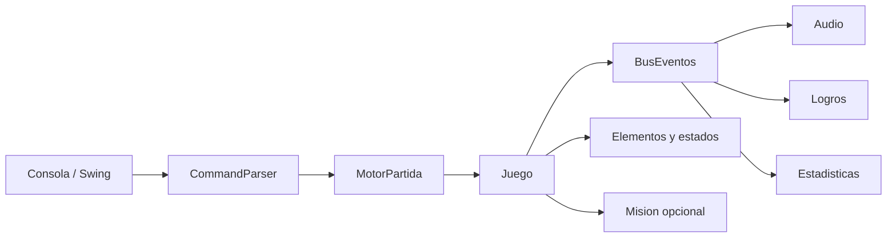
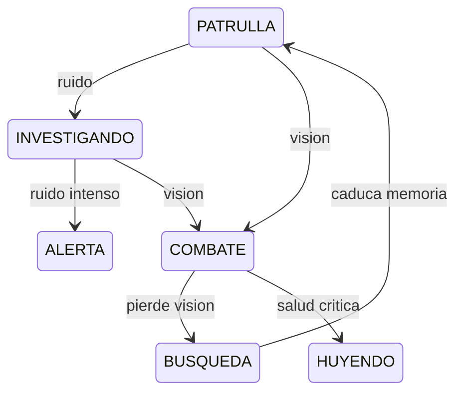

# Arquitectura roguelike

## Modulos

- `events`: bus sincrono por partida, reloj inyectable y eventos de dominio.
- `effects`: estrategias temporales y `GestorEstados` por personaje.
- `model.elements`: puertas, terminales, trampas, cobertura y destruccion.
- `inventory`: intercambio transaccional y recetas de crafting.
- `ai`: percepcion, ruido, memoria y maquina State/Strategy.
- `missions` y `progression`: objetivos, campana, XP y habilidades.
- `procedural`: habitaciones, laberintos y cuevas reproducibles.
- `persistence`: savegame versionado y replay con huella final.
- `achievements` y `stats`: proyecciones desacopladas que escuchan eventos.

`MotorPartida` conserva la orquestacion historica. Las nuevas reglas residen en
servicios y agregados especializados; consola y Swing siguen usando el mismo
`Juego` y el mismo parser.



## Flujo de turno e IA



El turno procesa efectos iniciales, accion, aliados, NPC, incendios y efectos
finales. La decision de IA produce una `AccionIA` explicable antes de ejecutarla.

## Compatibilidad

- Los constructores antiguos de `Arma` crean explicitamente armas de municion
  infinita para no romper escenarios historicos; las armas nuevas deben declarar
  cargador y `TipoMunicion`.
- Sin `Mision`, `Juego.jugadorGano()` usa la condicion de victoria original.
- TXT y JSON previos cargan sin campos de elementos. El JSON ampliado añade
  valores opcionales y validacion de IDs y conectividad.
- Campana, estadisticas persistentes, savegame y replay son opcionales.

## Persistencia y replay

`escenario.json` describe una plantilla. `partida.json` captura estado mutable,
incluidos elementos interactivos, progresion, estadisticas y logros, y usa
`PartidaGuardada.VERSION_ACTUAL`.

A partir del **savegame v2**, tambien se guardan todos los aliados registrados,
sus indices de evacuacion (referidos al orden del historial), la condicion de
victoria y la formacion tactica. Al cargar se reconstruye una sola instancia
de cada aliado, compartida por los indices de activos y evacuados. Asi, una
partida guardada tras una evacuacion parcial puede seguir hasta completar
`JUGADOR_Y_ALIADOS`. Los savegames antiguos **v1** siguen siendo legibles
con los valores predeterminados historicos para estos campos no persistidos. `ReplayPartida` registra seed, configuracion,
comandos y hash SHA-256; reproducir vuelve a ejecutar comandos sobre una fabrica
determinista y compara la huella final.

### Versiones del replay

- **v1 (legado):** `ServicioReplay.hash(juego)` mantiene la huella antigua,
  que solo incorporaba el mapa ASCII, la salud, la energia y los pasos del
  jugador. La compatibilidad no garantiza deteccion de alteraciones del
  inventario o de personajes no representados en el mapa.
- **v2 (recomendada):** `ServicioReplay.hashCompleto(juego)` calcula una
  SHA-256 canonica a partir de `PersistenciaPartida.capturar(juego, 0L)`,
  incluyendo mapa, contenido de celdas, personajes, inventarios, equipo,
  estados, progresion, mision, puntuacion, estadisticas y logros. Los conjuntos
  se ordenan antes de calcular la huella; los inventarios mantienen su orden.
- El comando `salir` puede ser el ultimo del replay, pero no se admiten
  comandos posteriores a un final anticipado. Las versiones desconocidas,
  comandos vacios y documentos de mas de 16 MiB se rechazan al cargar.
- Esta es una **huella de integridad**, no una firma autentificada: quien pueda
  modificar simultaneamente el replay y su hash puede calcular una huella nueva.
  La fabrica debe reconstruir el juego con la misma configuracion y semilla.

Ejemplo de creacion programatica del replay v2:

```java
String huella = ServicioReplay.hashCompleto(juegoFinal);
ReplayPartida replay = new ReplayPartida(2, semilla,
        configuracion, comandosRegistrados, huella);
ServicioReplay.guardar(replay, archivo);
```

## Extensiones

Para un estado nuevo se implementa `EfectoEstado`; para un enemigo, un rol
`EnemigoTactico`; para una mision, `ObjetivoMision`; para un mapa, `GeneradorMapa`.
Ninguno exige modificar los adaptadores de consola y GUI.
